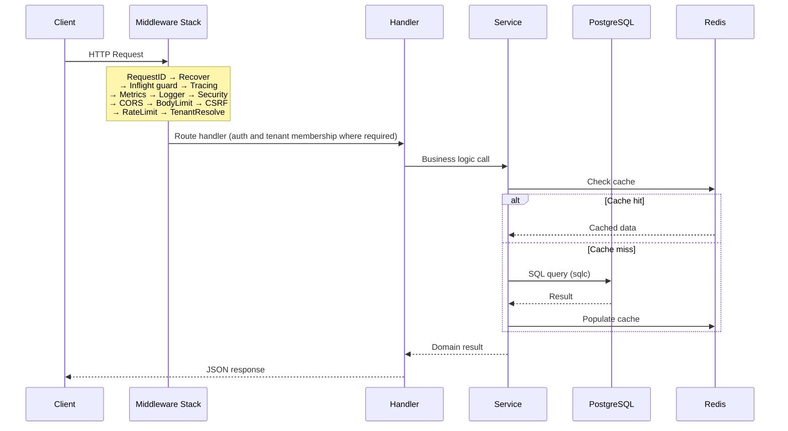

# Architecture — Toko API

## High-Level Overview

Toko API is a Go modular monolith backed by PostgreSQL and Redis. The repository builds separate `api`, `worker`, and `migrate` binaries; the API and worker share the domain packages and database. Each business domain lives in its own `internal/<domain>` package with handler, service, and data-access layers.

```
┌──────────────┐      ┌──────────────────────────────────────────────────┐
│  Storefront  │─────▶│                  toko-api (cmd/api)              │
│  (frontend)  │ REST │  ┌────────┬────────┬────────┬────────┬────────┐  │
└──────────────┘      │  │  auth  │catalog │  cart  │checkout│ order  │  │
                      │  ├────────┼────────┼────────┼────────┼────────┤  │
┌──────────────┐      │  │payment │shipping│voucher │campaign│  qa    │  │
│   Couriers   │─────▶│  ├────────┼────────┼────────┼────────┼────────┤  │
│(webhooks in) │      │  │reviews │loyalty │ push   │notify  │ audit  │  │
└──────────────┘      │  ├────────┼────────┼────────┼────────┼────────┤  │
                      │  │ admin  │analytics│events │platform│ health │  │
┌──────────────┐      │  └────────┴────────┴────────┴────────┴────────┘  │
│Payment Gw    │◀────▶│                                                  │
│(Midtrans/    │      └──────────┬──────────────────────┬────────────────┘
│ Xendit)      │                 │                      │
└──────────────┘           ┌─────▼─────┐          ┌─────▼─────┐
                           │PostgreSQL │          │   Redis   │
                           │  16       │          │   7       │
                           └───────────┘          └───────────┘
```

## Entrypoints

| Binary | Source | Purpose |
|--------|--------|---------|
| `api` | `cmd/api` | HTTP API server — all REST endpoints |
| `worker` | `cmd/worker` | Background webhook-delivery consumer |
| `migrate` | `cmd/migrate` | Schema migration runner (embeds SQL files) |
| tools | `cmd/tools/*` | Maintenance CLIs (`tenant_guard`, `backfill_tenant`) |

## Package Architecture

```
internal/
├── admin/          # Admin CRUD handlers (catalog, orders, analytics)
├── analytics/      # Sales analytics service with materialized views
├── app/            # Application wiring helpers
├── audit/          # Audit logging with sampling and HTTP recorder
├── auth/           # JWT authentication, sessions, password reset, email verification
├── cache/          # Generic cache abstractions
├── campaign/       # Flash-sale campaign management
├── cart/           # Cart lifecycle (create, items, voucher, merge, quotes)
├── catalog/        # Product catalog with Redis caching
├── checkout/       # Checkout transaction (order + inventory reservation), then payment intent
├── common/         # Shared utilities (auth context, JSON responses, email, idempotency)
├── config/         # Environment-driven configuration via koanf
├── db/
│   ├── gen/        # sqlc-generated Go code (DO NOT EDIT)
│   └── queries/    # SQL source files for sqlc
├── events/         # Domain event bus with notifier fan-out
├── favorites/      # Wishlist / favorites
├── health/         # Liveness and readiness probes
├── http/           # HTTP-layer helpers
├── lock/           # Distributed locking (Redis)
├── loyalty/        # Points-based loyalty program
├── notifications/  # In-app notification centre
├── notify/         # Outbound webhook delivery with HMAC, retry, DLQ
├── obs/            # Observability: Prometheus, OpenTelemetry, structured logging
├── order/          # Order queries and admin status transitions
├── payment/        # Payment intent, webhook handlers (Midtrans, Xendit)
├── platform/       # Cross-cutting platform handlers (privacy, returns, tenants)
├── pricing/        # Tax and pricing calculations
├── push/           # Web push (VAPID) subscriptions and delivery
├── qa/             # Product Q&A
├── queue/          # Redis-based task queue with DLQ and visibility timeouts
├── ratelimit/      # Sliding-window rate limiter (global, IP, user, login)
├── recommendations/# Collaborative-filtering recommendation engine
├── repo/           # Repository pattern helpers
├── resilience/     # Circuit breakers, jittered retry, HTTP client wrapper
├── reviews/        # Product reviews with aggregated stats
├── security/       # CORS, CSRF, HSTS, body-size limits
├── services/       # Cross-domain service adapters (tenant-scoped repos)
├── shipping/       # Shipping cost estimation (RajaOngkir), tracking webhooks
├── tenant/         # Multi-tenant resolver (header / subdomain)
├── user/           # User profile and address management
└── voucher/        # Voucher engine (percentage, fixed, free-shipping, per-user limits)
```

## Data Layer

### PostgreSQL (primary store)

- 38 migrations from `000001_create_users_table` through `000038_recommendations_tracking`.
- SQL queries authored in `internal/db/queries/` and code-generated by **sqlc**.
- Key tables: `users`, `products`, `product_variants`, `orders`, `order_items`, `payments`, `carts`, `cart_items`, `vouchers`, `tenants`, `tenant_memberships`, `audit_logs`, `domain_events`, `webhook_endpoints`, `webhook_deliveries`, `queue_dlq`.

### Redis

| Use case | Key pattern |
|----------|------------|
| Catalog cache | `{REDIS_CACHE_PREFIX}:tenant:{tenant_id}:catalog:products:list:popular` and `...:detail:{slug}` (default prefix: `cache`) |
| Analytics cache | `{REDIS_CACHE_PREFIX}:analytics:sales:{from}:{to}` and `...:top:{limit}:{offset}` (not tenant-keyed) |
| Idempotency guard | `idem:{sha256(Idempotency-Key)}` |
| Payment webhook replay | `wh:{provider}:{sha256(body)}` |
| Shipping webhook replay | `shwh:{courier}:{sha256(body)}` |
| Outbound webhook replay | `wh:{endpoint_uuid}:{event_uuid}` |
| Distributed delivery locks | `lock:delivery:{delivery_uuid}` |
| Task queue | `{QUEUE_REDIS_PREFIX}:queue:{kind}`, `{QUEUE_REDIS_PREFIX}:{kind}:processing`, and `{QUEUE_REDIS_PREFIX}:dedup:{kind}:{key}` (default prefix: `q`) |
| Rate limiting | `{RATE_LIMIT_REDIS_PREFIX}{scope}:{key}` (default prefix: `rl:`) |

## Request Flow



The API middleware stack is ordered as request ID, client IP, recovery, route pattern, in-flight limit, optional tracing and metrics, request logging, security headers, CORS, body limit, and CSRF. The `/api/v1` router then applies rate limits and tenant resolution; authentication and active-membership checks are route-specific, so public catalog and webhook routes remain unauthenticated.

## Deployment Architecture

The active production workflow is `.github/workflows/deploy.yml`. On a push to `main`, it runs Go tests, builds Linux/amd64 `api`, `worker`, and `migrate` binaries, uploads them over SSH to `/opt/toko-api/bin/*.new`, runs `migrate.new up` using the host's `.env`, replaces the binaries after a successful migration, restarts the `toko-api` and `toko-worker` systemd services, and verifies both services are active.

The repository also contains a separate Kubernetes deployment path under `deploy/k8s/`; it is not invoked by the production workflow and must be run manually. Build and publish an immutable image, substitute its tag in `migrate-job.yaml`, `deployment.yaml`, and `worker.yaml`, run the migration Job to completion, then apply the API and worker Deployments. The image embeds migrations and exposes `/app/api`, `/app/worker`, and `/app/migrate`.

Both paths expect PostgreSQL and Redis configuration from the deployment environment. Choose one path for an environment and keep its migration and application artifacts on the same release.

## Key Integrations

| System | Purpose | Adapter |
|--------|---------|---------|
| **Midtrans** | Payment gateway | `internal/payment` |
| **Xendit** | Payment gateway (alt) | `internal/payment` |
| **RajaOngkir** | Shipping rates + tracking | `internal/shipping` |
| **SMTP** | Transactional email | `internal/common` (SMTPSender) |
| **Prometheus** | Metrics export | `internal/obs` |
| **OpenTelemetry** | Distributed tracing | `internal/obs` |

## Cross-Cutting Concerns

| Concern | Implementation |
|---------|---------------|
| Authentication | HS256 JWT access tokens plus PostgreSQL-backed refresh sessions via `lestrrat-go/jwx` |
| Multi-tenancy | Header/subdomain resolver + membership middleware |
| Rate limiting | Redis sliding-window (global, IP, user, login) |
| Idempotency | Redis-backed `Idem` middleware |
| Circuit breaking | `internal/resilience` for the webhook-delivery HTTP client; payment and shipping clients currently use their own HTTP clients |
| Audit trail | Sampled HTTP recorder on selected auth/admin routes writing to `audit_logs` |
| Observability | Prometheus counters/histograms, OTLP traces, zerolog |
| Graceful shutdown | Readiness toggle → drain in-flight → close pools |
