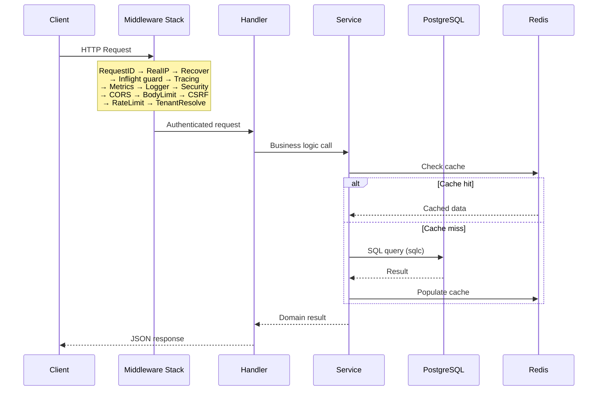

# Architecture — Toko API

## High-Level Overview

Toko API is a monolithic Go HTTP service backed by PostgreSQL and Redis. It follows a **modular-monolith** layout: each business domain lives in its own `internal/<domain>` package with handler, service, and data-access layers, but all domains compile into a single binary and share one database.

```
┌──────────────┐      ┌──────────────────────────────────────────────────┐
│  Storefront  │─────▶│                  toko-api (cmd/api)              │
│  (frontend)  │ REST │  ┌────────┬────────┬────────┬────────┬────────┐  │
└──────────────┘      │  │  auth  │catalog │  cart  │checkout│ order  │  │
                      │  ├────────┼────────┼────────┼────────┼────────┤  │
┌──────────────┐      │  │payment │shipping│voucher │campaign│  qa    │  │
│   Couriers   │─────▶│  ├────────┼────────┼────────┼────────┼────────┤  │
│(webhooks in) │      │  │reviews │loyalty │ push   │notify  │ audit  │  │
└──────────────┘      │  ├────────┼────────┼────────┼────────┼────────┤  │
                      │  │ admin  │analytics│events │platform│ health │  │
┌──────────────┐      │  └────────┴────────┴────────┴────────┴────────┘  │
│Payment Gw    │◀────▶│                                                  │
│(Midtrans/    │      └──────────┬──────────────────────┬────────────────┘
│ Xendit)      │                 │                      │
└──────────────┘           ┌─────▼─────┐          ┌─────▼─────┐
                           │PostgreSQL │          │   Redis   │
                           │  16       │          │   7       │
                           └───────────┘          └───────────┘
```

## Entrypoints

| Binary | Source | Purpose |
|--------|--------|---------|
| `api` | `cmd/api` | HTTP API server — all REST endpoints |
| `worker` | `cmd/worker` | Background job consumer (webhooks, email, analytics) |
| `migrate` | `cmd/migrate` | Schema migration runner (embeds SQL files) |
| tools | `cmd/tools/*` | Maintenance CLIs (`tenant_guard`, `backfill_tenant`) |

## Package Architecture

```
internal/
├── admin/          # Admin CRUD handlers (catalog, orders, analytics)
├── analytics/      # Sales analytics service with materialized views
├── app/            # Application wiring helpers
├── audit/          # Audit logging with sampling and HTTP recorder
├── auth/           # JWT authentication, sessions, password reset, email verification
├── cache/          # Generic cache abstractions
├── campaign/       # Flash-sale campaign management
├── cart/           # Cart lifecycle (create, items, voucher, merge, quotes)
├── catalog/        # Product catalog with Redis caching
├── checkout/       # Atomic checkout (reservation → order → payment intent)
├── common/         # Shared utilities (auth context, JSON responses, email, idempotency)
├── config/         # Environment-driven configuration via koanf
├── db/
│   ├── gen/        # sqlc-generated Go code (DO NOT EDIT)
│   └── queries/    # SQL source files for sqlc
├── events/         # Domain event bus with notifier fan-out
├── favorites/      # Wishlist / favorites
├── health/         # Liveness and readiness probes
├── http/           # HTTP-layer helpers
├── lock/           # Distributed locking (Redis)
├── loyalty/        # Points-based loyalty program
├── notifications/  # In-app notification centre
├── notify/         # Outbound webhook delivery with HMAC, retry, DLQ
├── obs/            # Observability: Prometheus, OpenTelemetry, structured logging
├── order/          # Order queries and admin status transitions
├── payment/        # Payment intent, webhook handlers (Midtrans, Xendit)
├── platform/       # Cross-cutting platform handlers (privacy, returns, tenants)
├── pricing/        # Tax and pricing calculations
├── push/           # Web push (VAPID) subscriptions and delivery
├── qa/             # Product Q&A
├── queue/          # Redis-based task queue with DLQ and visibility timeouts
├── ratelimit/      # Sliding-window rate limiter (global, IP, user, login)
├── recommendations/# Collaborative-filtering recommendation engine
├── repo/           # Repository pattern helpers
├── resilience/     # Circuit breakers, jittered retry, HTTP client wrapper
├── reviews/        # Product reviews with aggregated stats
├── security/       # CORS, CSRF, HSTS, body-size limits
├── services/       # Cross-domain service adapters (tenant-scoped repos)
├── shipping/       # Shipping cost estimation (RajaOngkir), tracking webhooks
├── tenant/         # Multi-tenant resolver (header / subdomain)
├── user/           # User profile and address management
└── voucher/        # Voucher engine (percentage, fixed, free-shipping, per-user limits)
```

## Data Layer

### PostgreSQL (primary store)

- 38 migrations from `000001_create_users_table` through `000038_recommendations_tracking`.
- SQL queries authored in `internal/db/queries/` and code-generated by **sqlc**.
- Key tables: `users`, `products`, `product_variants`, `orders`, `order_items`, `payments`, `carts`, `cart_items`, `vouchers`, `tenants`, `tenant_memberships`, `audit_logs`, `domain_events`, `webhook_endpoints`, `webhook_deliveries`, `queue_dlq`.

### Redis

| Use case | Key pattern |
|----------|------------|
| Catalog cache | `{prefix}:catalog:*` |
| Analytics cache | `{prefix}:analytics:*` |
| Idempotency guard | `idem:{key}` |
| Webhook replay protection | `replay:webhook:{id}` |
| Distributed locks | `lock:{resource}` |
| Task queue | `{prefix}:queue:*` |
| Rate limiting | `rl:{scope}:{key}` |

## Request Flow



## Deployment Architecture

```
┌─────────────────────────────────────────────┐
│              Kubernetes Cluster             │
│                                             │
│  ┌──────────────┐    ┌──────────────┐       │
│  │  API Deploy  │    │ Worker Deploy│       │
│  │  (replicas)  │    │  (replicas)  │       │
│  └──────┬───────┘    └──────┬───────┘       │
│         │                   │               │
│  ┌──────▼───────────────────▼───────┐       │
│  │   Migrate Job (runs first)       │       │
│  └──────────────────────────────────┘       │
│                                             │
│  ┌──────────────┐    ┌──────────────┐       │
│  │  PostgreSQL  │    │    Redis     │       │
│  └──────────────┘    └──────────────┘       │
│                                             │
│  ┌──────────────┐    ┌──────────────┐       │
│  │  Prometheus  │    │   Grafana    │       │
│  └──────────────┘    └──────────────┘       │
└─────────────────────────────────────────────┘
```

Deploy sequence:
1. Build immutable image (API + Worker + Migrate binaries).
2. Run `migrate-job.yaml` to completion.
3. Roll out `deployment.yaml` (API) and `worker.yaml` (Worker).

## Key Integrations

| System | Purpose | Adapter |
|--------|---------|---------|
| **Midtrans** | Payment gateway | `internal/payment` |
| **Xendit** | Payment gateway (alt) | `internal/payment` |
| **RajaOngkir** | Shipping rates + tracking | `internal/shipping` |
| **SMTP** | Transactional email | `internal/common` (SMTPSender) |
| **Prometheus** | Metrics export | `internal/obs` |
| **OpenTelemetry** | Distributed tracing | `internal/obs` |

## Cross-Cutting Concerns

| Concern | Implementation |
|---------|---------------|
| Authentication | JWT (access + refresh) via `lestrrat-go/jwx` |
| Multi-tenancy | Header/subdomain resolver + membership middleware |
| Rate limiting | Redis sliding-window (global, IP, user, login) |
| Idempotency | Redis-backed `Idem` middleware |
| Circuit breaking | `internal/resilience` with configurable thresholds |
| Audit trail | Sampled HTTP recorder writing to `audit_logs` |
| Observability | Prometheus counters/histograms, OTLP traces, zerolog |
| Graceful shutdown | Readiness toggle → drain in-flight → close pools |
